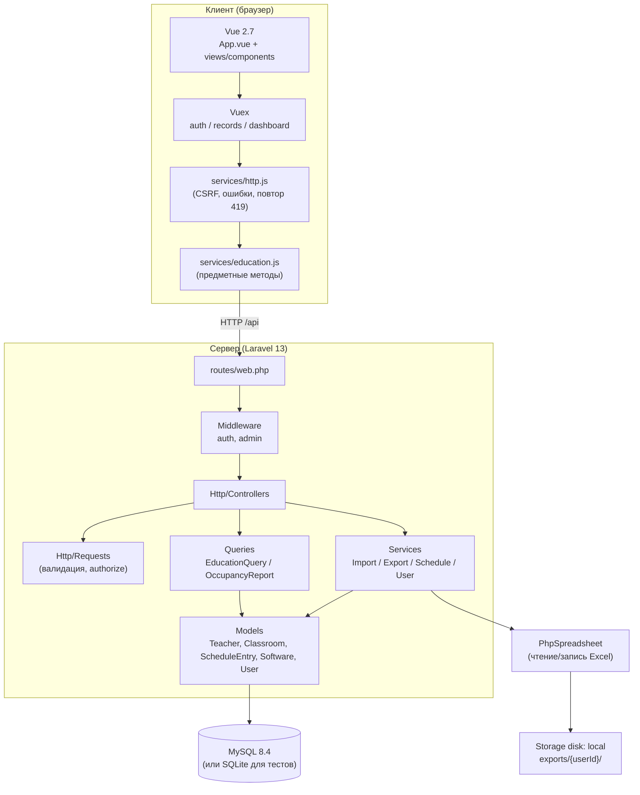
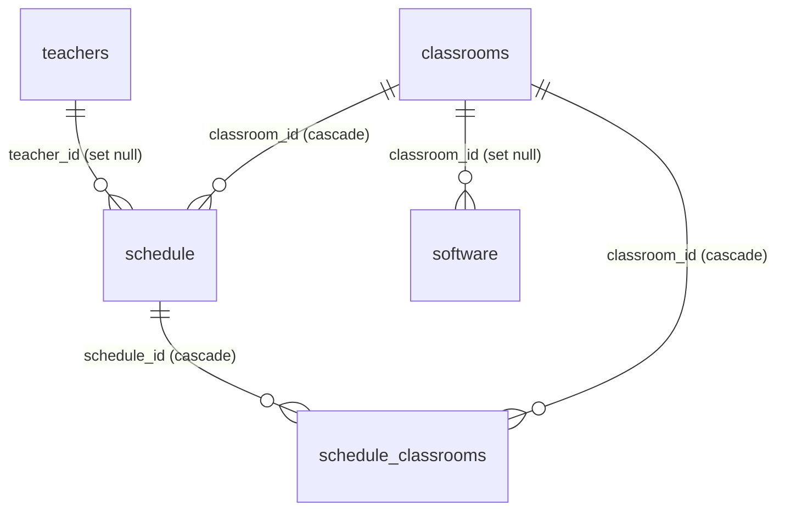

# Архитектура HSPM-App

Приложение «Учебный отдел ВШПМ» — SPA для управления преподавателями, аудиториями,
программным обеспечением и расписанием. Серверная часть — Laravel 13, клиент — Vue 2.7
с Vuex. Обмен данными — JSON по внутреннему API под `/api`, аутентификация — cookie-сессия
Laravel, экспорт/импорт — файлы Excel через PhpSpreadsheet.

Этот документ описывает устройство системы на уровне модулей и их взаимодействия.
Краткое техническое резюме см. в [SYSTEM_REPORT.md](SYSTEM_REPORT.md), пошаговую
установку — в [README.md](../README.md) и [DEVELOPMENT.md](DEVELOPMENT.md).

## Содержание

- [Слои приложения](#слои-приложения)
- [Разделение ответственности](#разделение-ответственности)
- [Ключевые сценарии](#ключевые-сценарии)
- [Ключевые алгоритмы](#ключевые-алгоритмы)
- [Модель данных](#модель-данных)
- [Обработка ошибок](#обработка-ошибок)
- [Принятые решения и компромиссы](#принятые-решения-и-компромиссы)
- [Ограничения](#ограничения)

## Слои приложения



## Разделение ответственности

| Слой | Каталог | Ответственность |
| --- | --- | --- |
| Маршруты | `routes/web.php` | Регистрация эндпоинтов, middleware `auth`/`admin` |
| Контроллеры | `app/Http/Controllers` | Приём запроса, вызов сервиса/запроса, формирование ответа |
| Валидация | `app/Http/Requests` | Правила полей и авторизация `authorize()` |
| Запросы | `app/Queries` | Фильтры, сортировка, агрегация (только разрешённые поля) |
| Сервисы | `app/Services` | Бизнес-логика импорта/экспорта, транзакции, сопоставление |
| Модели | `app/Models` | Eloquent-модели, связи, касты, fillable |
| Ресурсы | `app/Http/Resources` | Плоское представление расписания для клиента |
| Клиент | `resources/js` | Vue-компоненты, Vuex-хранилища, API-клиент |

## Ключевые сценарии

### Чтение списка

```
GET /api/teachers?search=Иванов&per_page=50
  → TeacherController::index (ResourceController)
  → EducationQuery::for('teachers', $filters)  // разрешённые фильтры + сортировка
  → paginate(50)
  → present($item) = $model->toArray()
```

### Сохранение занятия (транзакция)

```
POST/PUT /api/schedule
  → ScheduleController::store/update
  → ScheduleRequest (валидация + authorize admin)
  → ScheduleService::save (в транзакции):
      1. RoomParser::parse(classrooms) → аудитории
      2. Classroom::firstOrCreate(...) → id
      3. dedup_key = ScheduleKey::make(...)
      4. save + rooms()->sync($roomIds)
```

### Импорт Excel (атомарно)

```
POST /api/import
  → ImportController → ImportService::import
    1. IOFactory::load → Spreadsheet
    2. выбор парсера: TeacherParser | ClassroomParser | ScheduleParser | SoftwareParser
    3. ImportWriter::save (в транзакции, пакетами по 200 строк)
  → ошибка в любом шаге откатывает весь импорт
```

### Поиск свободных аудиторий

```
GET /api/classrooms/free?date=...&pair_number=...
  → FreeClassroomController
  → EducationQuery::for('classrooms', $filters)
  → whereDoesntHave('primaryLessons', занято) && whereDoesntHave('lessons', занято)
```

## Ключевые алгоритмы

### Ключ занятия (ScheduleKey::make)

Для дедупликации каждое занятие получает детерминированный `md5`-ключ, одинаковый при
ручном вводе и при импорте. Состав ключа:

- при наличии даты — `дата`, `время начала`, `дисциплина`, `группа`, `экзаменатор`;
- без даты (недельные сетки) — дополнительно `день недели` и `числитель/знаменатель`;
- если содержательных полей нет — запасной набор (`дата`, `время`, `тип занятия`,
  `аудитории`, `номер пары`), чтобы разные пустые строки не склеивались.

Время начала приводится к `HH:MM:SS` (дополняется `:00`). Уникальность `dedup_key`
обеспечивает идемпотентность повторного импорта.

### Разбор строки аудиторий (RoomParser::parse)

Регулярное выражение извлекает пары «корпус + номер» из строки вида «Д234, В105, ДО»:

- корпус — необязательный префикс `БМ`, `В` или `Д` (по умолчанию `Д`);
- номер — 2–4 цифры (допускаются точка и строчная буква), например `008`, `102`, `101а`;
- строка «ДО» (дистанционное обучение) не содержит номера и не создаёт аудиторию;
- результат дедуплицируется по паре «корпус|номер».

### Сопоставление преподавателя (ImportWriter::teacher)

При импорте расписания текст экзаменатора сопоставляется с существующими
преподавателями по фамилии и инициалам:

1. ФИО разбивается на части (фамилия, имя, отчество).
2. По фамилии выбираются кандидаты из справочника, загруженного один раз.
3. При единственном совпадении подставляется `teacher_id`.
4. Иначе `teacher_id = NULL`, а ФИО сохраняется текстом в поле `examiner`.
   Новые преподаватели при импорте не создаются.

### Импорт с заменой (replace)

При включённой опции замены у каждой строки файла должны быть `date` и `group_code`,
иначе импорт отклоняется целиком. После записи удаляются занятия групп из файла в его
диапазоне дат, отсутствующие в файле. Удаление ограничено группами и диапазоном дат
файла — посторонние занятия не затрагиваются.

### Чтение дат и времени Excel (ExcelValue)

- **Дата:** `DateTimeInterface`, Excel-серийный номер либо текст `YYYY-MM-DD`/`DD.MM.YYYY`;
  некорректные даты (например 31.02) дают `null`.
- **Время:** Excel-доля суток переводится в `HH:MM:SS`; текст разбирается регулярным
  выражением, извлекающим до двух значений (начало и окончание).
- **Текст:** `RichText` раскрывается в обычную строку; строка `008` не превращается в `8`.

### Отчёт по занятости (OccupancyReport)

Один SQL с `UNION` объединяет основные (`schedule.classroom_id`) и дополнительные
(`schedule_classrooms`) аудитории, затем условные `SUM(CASE...)` считают по каждой
аудитории: всего занятий, занятых записей, переносов, отмен.

## Модель данных

Таблицы: `users`, `teachers`, `classrooms`, `software`, `schedule`, `schedule_classrooms`.



Особенности:

- `schedule` хранит занятие с **основной** аудиторией (`classroom_id`) и набором
  **дополнительных** аудиторий (`schedule_classrooms`), что соответствует старой схеме
  и расширяет её.
- `dedup_key` (md5) в `schedule` обеспечивает идемпотентность повторного импорта.
- `teachers.middle_name` хранит пустую строку вместо NULL, чтобы UNIQUE
  `(last_name, first_name, middle_name)` защищал от дубликатов.
- Недельные сетки хранятся с `date = NULL` и заполненным `day_of_week`.

## Обработка ошибок

Единая точка — `bootstrap/app.php` (`withExceptions`). Для маршрутов `/api/*` ответы
всегда JSON:

| Ситуация | Код | Формат |
| --- | --- | --- |
| Ошибка валидации | 422 | `{success:false, error, errors}` |
| Не авторизован | 401 | `{success:false, error}` |
| Нарушение уникальности/связи | 409 | `{success:false, error}` |
| Прочая ошибка БД | 500 | общее сообщение (без SQL/параметров) |
| Нет прав | 403 | через `abort_unless` |

Успешные ответы имеют вид `{success:true, data, message}` (см. `Controller::success`).

## Принятые решения и компромиссы

- **Vue 2.7 сохранён** по исходному ТЗ; переход на Vue 3 не входит в объём работ.
- **SQL не формируется из пользовательских имён** колонок/таблиц: фильтры и справочники
  ограничены явными списками (`EducationQuery`, `LookupController`).
- **Пакетная запись** импорта/связей (чанки по 200) — число SQL зависит от числа пакетов,
  а не ячеек Excel.
- **Экспорт вне public/** и привязан к владельцу (`exports/{userId}/`), удаляется
  командой `hspm:exports-clean`.
- **Недельные сетки не разворачиваются в даты**: нет подтверждённых границ семестра
  и правил чередования недель. Это задокументированное ограничение, а не баг.

## Ограничения

- Календарное разворачивание недельных сеток и применение журнала переносов не реализованы.
- Несколько преподавателей в одной ячейке Excel остаются текстом в `examiner`.
- Импорт с `replace` требует дату и группу у каждой строки, иначе отклоняется целиком.

---

См. также: [README](../README.md), [MODULES.md](MODULES.md), [API.md](API.md), [DEVELOPMENT.md](DEVELOPMENT.md), [CONFIGURATION.md](CONFIGURATION.md).

